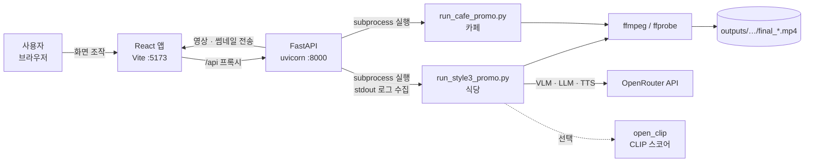
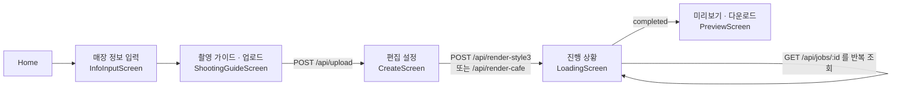
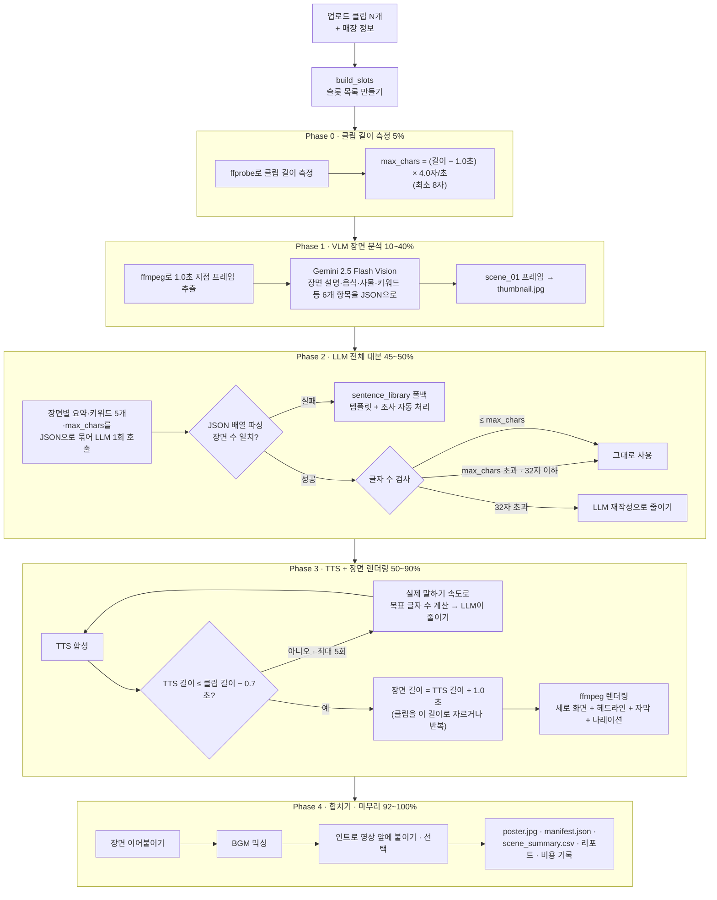
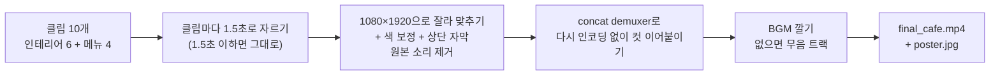

# 숏츠몽 (Shortsmong) — 숏폼 홍보 영상 자동 생성기

매장 사장님이 **짧은 영상 클립 여러 개를 업로드**하면, 자동으로

1. **영상 자르기** — 클립마다 나레이션 길이(또는 고정 길이)에 맞춰 잘라서 1080×1920 세로 화면으로 변환
2. **자막 생성** — Vision 모델(VLM)이 장면을 분석하고 LLM이 영상 전체 흐름에 맞는 대본을 작성
3. **TTS 삽입** — 대본을 음성으로 합성해 장면별로 넣고, BGM과 섞기

까지 처리해서 **완성된 숏폼 MP4**를 만들어 줍니다.

업종은 두 가지를 지원합니다.

| 업종 | 파이프라인 | 자막 | TTS | API 비용 |
|---|---|---|---|---|
| 🍜 식당 | `run_style3_promo.py` (Style 3) | VLM + LLM 자동 생성 (장면별) | ✅ | 있음 (OpenRouter) |
| ☕ 카페 | `run_cafe_promo.py` | 사장님이 입력한 문구 1개 (상단 고정) | ❌ | 없음 |

---

## 1. 시스템 구성



- **프론트엔드** (`react-app/`): 매장 정보 입력 → 촬영 가이드에 맞춰 클립 업로드 → 편집 옵션 선택 → 진행 상황 확인 → 결과 미리보기
- **백엔드** (`web/`): 업로드 파일 저장, 렌더링 작업 등록, 파이프라인을 **별도 프로세스로 실행**하고 그 출력(stdout)을 작업 로그로 쌓아 둠
- **파이프라인** (프로젝트 루트의 `run_*.py`): 실제 영상 처리 담당. 웹 없이 CLI로도 따로 실행할 수 있음

---

## 2. 사용자 워크플로우



| 단계 | 화면 | 하는 일 |
|---|---|---|
| ① | 매장 정보 입력 | 업종(식당/카페), 가게 이름, 위치, 메뉴(최대 3개), 포장·조리·내부 촬영 여부, 테이블 수를 입력합니다. 입력값으로 **촬영 슬롯 목록**이 만들어집니다. |
| ② | 촬영 가이드 | 슬롯마다 예시 영상(`public/가이드/*.mp4`)과 촬영 팁이 나옵니다. 모든 슬롯을 채우면 `/api/upload`로 올리고, 파일은 `uploads/<session_id>/scene_01.mp4 …` 형식으로 **슬롯 순서대로** 저장됩니다. |
| ③ | 편집 설정 | 자막 스타일·위치, TTS 목소리(미리듣기 가능), BGM, 인트로 영상을 고릅니다. 카페는 상단 자막 문구를 입력합니다. |
| ④ | 진행 상황 | 파이프라인이 찍는 `[progress:N%]` 로그를 읽어 5단계(클립 분석 → VLM → LLM 대본 → TTS·렌더링 → BGM 믹스)로 보여 줍니다. |
| ⑤ | 미리보기 | `/api/jobs/{id}/video`, `/api/jobs/{id}/thumbnail`에서 결과물을 받아 재생합니다. |

### 촬영 슬롯 구성 (식당)

업로드한 파일은 **이름순 = 슬롯 순서**로 짝지어집니다. 슬롯은 매장 옵션에 따라 이렇게 만들어집니다.

```
1. 대표 메뉴 (hook)          ← 첫 장면 훅
2. 매장 외부 (exterior)       ← 간판, 가게 이름과 위치 언급
3. 매장 내부 (interior)       ← has_interior 일 때만
4. 조리 과정 1, 2 (cooking)   ← has_cooking 일 때만
5. [메뉴마다] 클로즈업 + 들어올리기   ← 메뉴 수 × 2
6. 포장/테이크아웃 (packaging) ← has_packaging 일 때만
7. 매장 외부 전경 (wide_shot)  ← 방문을 권하는 마무리(CTA)
```

카페는 **인테리어 6개 + 메뉴 4개 = 10개 슬롯**으로 고정입니다.

---

## 3. 식당 파이프라인 (Style 3) — `run_style3_promo.py`

핵심 생각: **장면마다 따로 대사를 만들지 않고, 모든 장면의 Vision 분석 결과를 LLM에 한 번에 넘겨 처음부터 끝까지 이어지는 대본을 받는다.** 그리고 장면마다 들어갈 수 있는 글자 수는 **클립 길이로 계산**합니다.



### Phase별 상세

#### Phase 0 — 클립 길이로 글자 수 상한 정하기
- 한국어 TTS의 실제 말하기 속도(약 **4.0자/초**, `TTS_CPS`)를 기준으로, 나레이션이 **클립보다 1.0초 먼저 끝나도록** 장면별 `max_chars`를 계산합니다.
- 예: 5.0초 클립 → (5.0 − 1.0) × 4.0 = **16자**

#### Phase 1 — VLM 장면 분석
- 클립마다 1.0초 지점의 프레임 한 장을 뽑아 `google/gemini-2.5-flash`에 보냅니다.
- 응답 JSON: `scene_summary`, `detected_food_or_menu`, `detected_objects`, `keywords`(8개), `caption_candidate`, `visual_mood`
- VLM이 실패해도 파이프라인은 멈추지 않고 빈 결과로 계속 진행합니다.

#### Phase 2 — 전체 맥락 LLM 대본
- 프롬프트 규칙: **훅 → 전개 → 클라이맥스 → 방문 유도(CTA)**로 이어지는 하나의 이야기, 장면별 `max_chars` 준수, 문장을 중간에 자르지 않기, 매장 외부 장면에는 가게 이름과 위치 넣기, 확인되지 않은 정보 쓰지 않기
- 말투(`--style`)
  - `seosanam`: 단정하고 확신 있는 톤 (~이에요, ~거든요, ~이죠)
  - `dudley`: 부드럽게 돌려 말하는 톤 (~것 같아요, ~어요)
- **폴백**: LLM 응답을 읽지 못하거나 장면 수가 다르면 `sentence_library.py`의 장면 유형별 문장 템플릿에서 무작위로 고릅니다.
  - `{메뉴명+이에요}` → 받침에 따라 `마라탕이에요` / `꿔바로우예요`처럼 조사를 자동으로 고름 (`fill_vars`, `has_batchim`)
  - 메뉴 클로즈업은 VLM 키워드를 감각 표현으로 바꿔 넣음 (`extract_sensory_word`: "매콤" → "매콤한")
- 자막과 나레이션은 **같은 문장**을 씁니다. 화면에 보이는 글과 들리는 말이 일치합니다.

#### Phase 3 — TTS 합성 + 장면 렌더링 (영상 자르기)
1. **TTS 합성** — `synthesize_tts()`가 엔진에 맞게 처리합니다 (`openrouter`/`xai` → OpenRouter `/tts`, `edge` → Edge TTS, `piper` → 로컬 Piper)
2. **길이 검증 루프** — TTS가 `클립 길이 − 0.7초`를 넘으면, 실제 말하기 속도로 목표 글자 수를 다시 계산해 LLM에 문장을 줄이게 하고 다시 합성합니다 (최대 5회). 그래도 넘으면 오디오를 자르지 않고 그대로 씁니다.
3. **장면 길이 확정** — `장면 길이 = TTS 길이 + 1.0초`
4. **ffmpeg 렌더링** (`render_scene_shorts_reference`)
   - `-stream_loop -1` + `-t <장면 길이>`: 클립이 길면 **잘라내고**, 짧으면 **반복 재생**해서 나레이션이 끊기지 않게 합니다
   - 화면 배치 (1080×1920)

     ```
     ┌──────────────────────┐ 0
     │   헤드라인 (1~2줄)    │  ← --headline, 굵은 테두리 글씨
     ├──────────────────────┤ 320
     │                      │
     │   원본 클립           │  ← 1080×1280에 맞춰 잘라서 배치
     │   (채도·대비 보정)     │
     │                      │
     │   ┌──────────────┐   │ ~1500
     │   │  하단 자막    │   │  ← box / bold / highlight
     │   └──────────────┘   │
     ├──────────────────────┤ 1600
     │       (검정)          │
     └──────────────────────┘ 1920
     ```
   - 자막은 한 줄에 34 단위(한글은 2 단위로 셈)까지, 최대 2줄로 자동 줄바꿈합니다. `--subtitle-y`로 위치를 바꿀 수 있습니다.

#### Phase 4 — 합치기 · BGM · 인트로
- `concat_videos`로 장면 영상을 다시 인코딩하며 이어붙임 → `mix_bgm`으로 BGM을 영상 길이만큼 반복·자른 뒤 나레이션과 섞음 (`BGM_VOLUME`, `NARRATION_VOLUME`)
- 인트로 영상(`agro/`)을 고르면 본편 시작에 흰색 페이드인을 넣고 인트로를 앞에 붙입니다.
- 결과 기록: `manifest.json`, `scene_summary.csv`, `vlm_analysis.json`, `scene_report.md`, `cost_summary.xlsx`

#### 품질·비용 측정 (선택 기능)
- **CLIP 스코어**: 프레임과 VLM 키워드가 얼마나 잘 맞는지 0~100점으로 계산해 `scene_summary.csv`에 기록합니다. (`open_clip_torch`, `torch`, `Pillow`가 설치되어 있을 때만 동작)
- **비용 추적** (`CostTracker`): VLM·LLM·TTS 호출 수와 예상 비용(USD/KRW)을 계산합니다. OpenRouter 공개 가격 기준 추정치입니다.

---

## 4. 카페 파이프라인 — `run_cafe_promo.py`

LLM과 TTS 없이 **빠른 컷 편집 + 고정 자막 + BGM**만 하는 가벼운 파이프라인입니다. API 비용이 들지 않습니다.



- 자막은 사장님이 입력한 문구 하나를 **모든 컷 상단에 똑같이** 표시합니다 (직접 줄바꿈하면 그대로, 아니면 28 단위 기준으로 자동 줄바꿈).
- 클립마다 1.5초 → 10개 클립이면 **약 15초짜리 숏폼**이 됩니다.

---

## 5. 백엔드 API

| 메서드 | 경로 | 설명 |
|---|---|---|
| `POST` | `/api/upload` | 영상 여러 개 업로드 → `session_id` 돌려줌 (`uploads/<session_id>/scene_NN.ext`) |
| `POST` | `/api/render-style3` | 식당 파이프라인 시작 (`RenderConfig`) → `job_id` |
| `POST` | `/api/render-cafe` | 카페 파이프라인 시작 (`CafeRenderConfig`) → `job_id` |
| `GET` | `/api/jobs/{id}` | 작업 상태(`pending`/`running`/`completed`/`failed`)와 로그 |
| `GET` | `/api/jobs/{id}/video` | 결과 MP4 |
| `GET` | `/api/jobs/{id}/thumbnail` | 썸네일 (대표 메뉴 장면의 프레임) |
| `GET` | `/api/outputs-style3` | 최근 식당 결과물 목록 (최대 20개) |
| `POST` | `/api/tts-preview` | 고른 목소리로 샘플 문장 미리듣기 |
| `GET` | `/api/bgm`, `/api/bgm/{file}` | `bgm/*.mp3` 목록 / 파일 |
| `GET·POST·DELETE` | `/api/intros…` | `agro/` 인트로 영상 목록 / 업로드 / 삭제 |

**작업 실행 방식**: 렌더링 요청이 오면 FastAPI `BackgroundTasks`에서 파이프라인 스크립트를 `subprocess`로 실행합니다. stdout을 한 줄씩 `jobs[job_id]["logs"]`에 쌓고, 프론트엔드는 이 로그 안의 `[progress:N%]`, `[done] <경로>` 표시를 읽어 진행 상황을 보여 줍니다. 편집 설정(`RenderConfig`)은 `build_env()`에서 **환경변수**(`TTS_*`, `SUBTITLE_*`, `BGM_VOLUME` …)로 바뀌어 스크립트에 전달됩니다.

---

## 6. 결과물 구조

```
outputs/
├── gemini-style3/<run_id>/          # 식당
│   ├── final_style3.mp4             ★ 최종 결과
│   ├── thumbnail.jpg / poster.jpg
│   ├── frames/scene_NN.jpg          # VLM에 넣은 프레임
│   ├── tts/scene_NN.mp3             # 장면별 나레이션
│   ├── rendered/scene_NN.mp4        # 장면별 렌더링 결과
│   ├── manifest.json                # 모델·설정·VLM 결과·대본 전체
│   ├── scene_summary.csv            # 장면별 요약 + CLIP 스코어 + 비용
│   ├── vlm_analysis.json            # 장면별 VLM 결과와 LLM 입출력
│   ├── scene_report.md              # 사람이 읽기 좋은 장면별 리포트
│   └── cost_summary.xlsx            # API 비용 요약 (openpyxl 필요)
└── cafe/<run_id>/                   # 카페
    ├── final_cafe.mp4               ★ 최종 결과
    ├── poster.jpg
    └── clips/clip_NN.mp4
```

---

## 7. 설치 및 실행

### 사전 준비
- **Windows** (자막 폰트로 `C:\Windows\Fonts\malgun.ttf`, `malgunbd.ttf`를 사용합니다)
- Python 3.10+, Node.js 18+
- **ffmpeg / ffprobe**: `abc/ffmpeg/bin/` 또는 `ffmpeg/bin/`에 두거나 PATH에 등록
- **OpenRouter API 키** (식당 파이프라인용)
- **BGM**: 프로젝트 루트의 `bgm/` 폴더에 mp3를 넣어 두세요. 식당 파이프라인은 BGM을 고르지 않으면 `bgm/nastelbom-no-copyright-music-490159.mp3`를 기본으로 쓰고, 이 파일이 없으면 실패합니다.

### 1) 백엔드

```powershell
python -m venv .venv
.\.venv\Scripts\pip install -r requirements.txt
```

프로젝트 루트에 `.env.openrouter` 파일을 만들고 키를 넣습니다.

```
OPENROUTER_API_KEY=sk-or-...
```

(선택) CLIP 스코어를 쓰려면:

```powershell
.\.venv\Scripts\pip install open_clip_torch torch pillow
```

서버 실행 (`서버1_.bat`과 같음):

```powershell
python -m uvicorn web.app:app --host 0.0.0.0 --port 8000 --reload
```

### 2) 프론트엔드 (`서버2_.bat`과 같음)

```powershell
cd react-app
npm install
npm run dev
```

브라우저에서 `http://localhost:5173` 접속. `/api` 요청은 Vite 프록시를 거쳐 `localhost:8000`으로 전달됩니다.

> `run.bat`과 `.claude/launch.json`의 `shortsform-web`은 백엔드를 **8002** 포트로 띄웁니다. React 앱과 함께 쓸 때는 Vite 프록시 대상인 **8000** 포트(`서버1_.bat`)로 실행하세요.

### 3) CLI로 직접 실행

```powershell
# 식당
$env:SOURCE_DIR = "C:\path\to\clips"
python run_style3_promo.py `
  --run-id test-001 `
  --store-name "해피마라탕" --store-location "아산 신창면" `
  --menu-names "마라탕,꿔바로우" `
  --has-cooking --has-packaging --has-interior --table-count 12 `
  --style seosanam --tts openrouter `
  --headline "마라탕 땡기는 날\n여긴 어때?" `
  --bgm bgm\your-bgm.mp3

# 카페
$env:SOURCE_DIR = "C:\path\to\cafe_clips"
python run_cafe_promo.py --caption-text "성수동 감성 카페" --subtitle-style box --bgm bgm\your-bgm.mp3
```

`--slot-files`를 주지 않으면 `SOURCE_DIR` 안의 영상 파일을 **이름순으로** 슬롯에 넣습니다.

---

## 8. 주요 환경변수

| 변수 | 기본값 | 설명 |
|---|---|---|
| `OPENROUTER_API_KEY` | — | `.env.openrouter`에 넣어도 됨 |
| `SOURCE_DIR` | `abc/마라탕매장 영상 원본_260304` | 입력 클립 폴더 |
| `STYLE3_SCRIPT_MODEL` | `google/gemini-2.5-flash` | 대본 생성용 LLM |
| `TTS_ENGINE` | `xai` | `openrouter` · `xai` (둘 다 OpenRouter `/tts`) · `edge` · `piper` |
| `TTS_MODEL` / `TTS_VOICE` / `TTS_SPEED` | `x-ai/grok-voice-tts-1.0` / `eve` / `1.0` | OpenRouter TTS 설정 |
| `TTS_EDGE_VOICE` / `TTS_EDGE_RATE` / `TTS_EDGE_PITCH` | `ko-KR-SunHiNeural` / `+12%` / `+20Hz` | Edge TTS 설정 |
| `PIPER_MODEL` | — | Piper `.onnx` 모델 경로 |
| `SUBTITLE_STYLE` | `box` | `box` · `bold` · `highlight` |
| `SUBTITLE_FONT_SIZE` / `HEADLINE_FONT_SIZE` | `46` / `92` | 글자 크기 |
| `SUBTITLE_COLOR` / `SUBTITLE_BOX_COLOR` / `SUBTITLE_BOX_ALPHA` | `white` / `black` / `1` | 자막 색상 |
| `SUBTITLE_FONT` | (맑은 고딕 Bold) | 사용자 TTF/OTF 경로 |
| `BGM_VOLUME` / `NARRATION_VOLUME` | `0.09` / `1.55` | 오디오 믹싱 비율 |

---

## 9. 디렉터리 구조

```
.
├── run_style3_promo.py            # 식당 파이프라인 (VLM → LLM → TTS → 렌더링)
├── run_cafe_promo.py              # 카페 파이프라인 (트리밍 → 자막 → 컷 편집 → BGM)
├── gemini_script_compare_common.py# 공통 모듈: OpenRouter 호출, VLM, TTS, ffmpeg 렌더링·이어붙이기·BGM
├── inspect_vision_models.py       # API 키 로드, ffmpeg 찾기, 프레임 추출, JSON 파싱
├── sentence_library.py            # 장면 유형별 문장 템플릿 + 조사 처리 + 감각 표현 (LLM 폴백용)
├── requirements.txt
├── web/
│   ├── app.py                     # FastAPI 진입점 + 공통 엔드포인트
│   ├── common.py                  # RenderConfig, 작업 저장소, subprocess 실행, 환경변수 변환
│   └── routers/
│       ├── style3.py              # /api/render-style3
│       └── cafe.py                # /api/render-cafe
├── react-app/                     # 프론트엔드 (React 18 + Vite)
│   ├── public/가이드/*.mp4        # 촬영 가이드 예시 영상
│   └── src/pages/                 # Home → Info → Guide → Create → Loading → Preview
├── assets/                        # 대본 샘플 CSV, TTS 목소리 샘플
├── bgm/                           # (직접 준비) BGM mp3
├── agro/                          # (자동 생성) 인트로 영상
├── uploads/                       # (자동 생성) 업로드 세션
└── outputs/                       # (자동 생성) 렌더링 결과
```

---

## 10. 참고 및 제약 사항

- 작업 상태(`jobs`)는 **메모리**에만 저장됩니다. 서버를 재시작하면 진행 중이던 작업 정보는 사라집니다 (결과 파일은 `outputs/`에 남음).
- 클립과 슬롯은 **파일 이름순**으로 짝지어집니다. 업로드 API가 `scene_01`, `scene_02` … 형식으로 이름을 바꿔 저장하므로 웹에서 올리면 순서가 유지됩니다.
- 폰트 경로가 Windows 기준으로 정해져 있습니다. 다른 OS에서는 `SUBTITLE_FONT`를 지정하고 `FONT` 상수를 수정해야 합니다.
- 비용은 OpenRouter 공개 가격과 고정 환율(₩1,370/$)로 계산한 **추정치**입니다.
- 원본 대용량 영상(`*.MOV`)과 `abc/ffmpeg/`는 용량 때문에 Git에 올리지 않습니다 (`.gitignore`).
